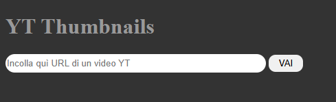

# Anteprime Video Youtube

## Descrizione

Questa semplice barra permette, incollando URL di un video Youtube, di trasformare l'URL in un altro indirizzo che ti porta alla Thumbnail (immagine di anteprima) del video.  

Come formati URL supporta solo questo tipo:  
`https://www.youtube.com/watch?v=-yqNI2GfXMQ`
